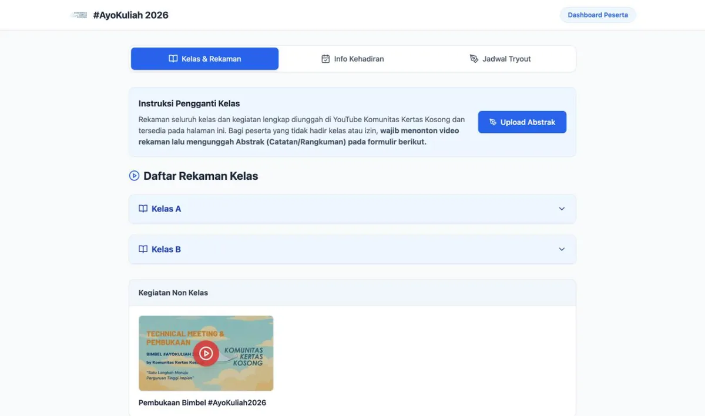
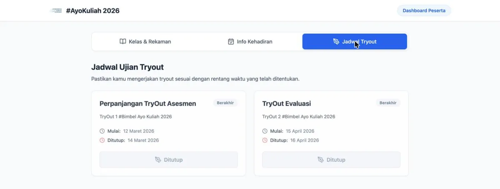

# Kertas Kosong

Tryout and student portal for Bimbel Ayo Kuliah 2026, the university entrance study program run by Komunitas Kertas Kosong.

Live at [kertas-kosong.web.app](https://kertas-kosong.web.app).

## Screenshots





## Pages

| URL | Content |
|---|---|
| `/` | Community landing page (placeholder for now) with a button to the student portal |
| `/portal-bimbel` | Student portal with three tabs: class recordings, attendance, and the tryout schedule |
| `/tryout` | Tryout subtests with a countdown, shown only while a tryout is open |

The portal tabs:

- **Kelas & Rekaman**: YouTube recordings grouped by class (Kelas A, Kelas B), week, and subtest, plus non-class events. Students who missed a class watch the recording and upload an abstract through the linked form.
- **Info Kehadiran**: attendance recaps for each class.
- **Jadwal Tryout**: each tryout with its start and close dates and its status.

## Data

All content comes from Firestore and is read-only for visitors.

| Collection | Used for |
|---|---|
| `rekaman` | Recordings: `kelas`, `minggu`, `subtest`, `judul`, `url`, `kategori` |
| `kehadiran` | Attendance links and recaps per class |
| `jadwal_tryout` | Tryout windows: `tanggal_mulai`, `tanggal_selesai` |
| `tryout` | Subtest links, fetched only while a tryout window is open |
| `tautan_penting` | Shared links such as the abstract upload form |

## Stack

React 18, Vite 5, Tailwind CSS 3, React Router 6, and the Firebase JS SDK 10 (Firestore). Hosted on Firebase Hosting, with every path rewritten to `index.html` for client-side routing.

```
src/
  App.jsx              routes
  firebase.js          Firebase app and Firestore from the VITE_FIREBASE_* variables
  pages/Landing.jsx    /
  pages/PortalBimbel.jsx  /portal-bimbel
  pages/Tryout.jsx     /tryout
```

## Running locally

Create `.env` with the Firebase web config (not committed):

```sh
VITE_FIREBASE_API_KEY=...
VITE_FIREBASE_AUTH_DOMAIN=...
VITE_FIREBASE_PROJECT_ID=...
VITE_FIREBASE_STORAGE_BUCKET=...
VITE_FIREBASE_MESSAGING_SENDER_ID=...
VITE_FIREBASE_APP_ID=...
VITE_FIREBASE_MEASUREMENT_ID=...
```

Then:

```sh
npm install
npm run dev
```

## Deploy

```sh
npm run build
firebase deploy --only hosting
```

## License

All rights reserved. The source code is public for reference only. See [LICENSE](LICENSE).
